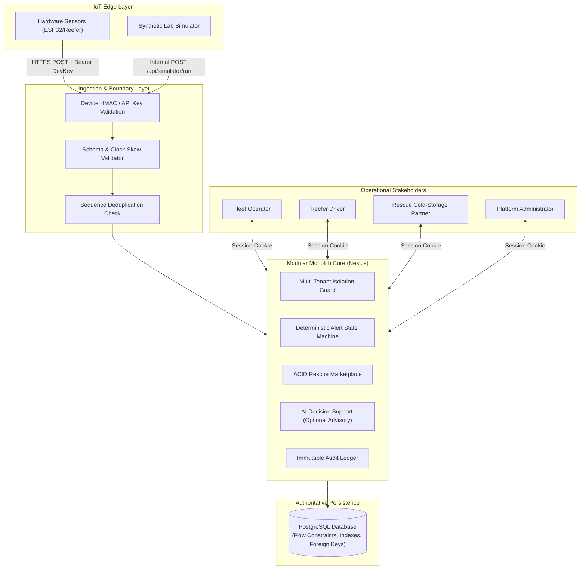
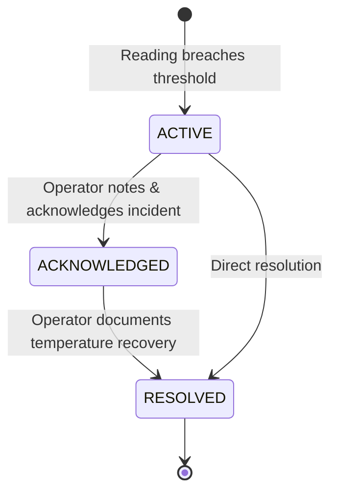
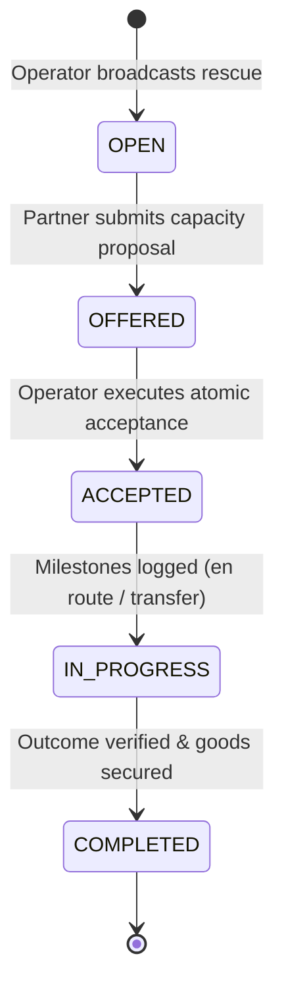

# Annapurna Rebuilt — Architecture & Technical Specifications

## Architectural Overview
Annapurna Rebuilt is designed as a **modular monolith** optimized for deployment on Vercel and managed PostgreSQL (e.g. Neon, Supabase, AWS RDS). PostgreSQL serves as the single authoritative system of record, guaranteeing ACID compliance, strict concurrency controls, and tamper-evident audit trails.



---

## Core Domain Modules

### 1. Identity & Access (`src/lib/auth`)
- Implements HMAC-SHA256 cryptographically signed session tokens.
- Secured via HTTP-only, SameSite=Lax cookies with timing-safe signature comparison to prevent timing attacks.
- Enforces role-based access control (`ADMIN`, `OPERATOR`, `DRIVER`, `PARTNER`).

### 2. Multi-Tenant Organization Boundary (`src/lib/org`)
- Every operational entity (`Shipment`, `Device`, `Vehicle`, `Alert`, `RescueOpportunity`) belongs to an `Organization`.
- Server-side authorization check `assertOrgAccess(userId, userRole, orgId)` runs at every sensitive API endpoint. Non-admin users cannot read or mutate records belonging to other tenants.

### 3. Fleet & Edge Hardware Provisioning (`src/lib/fleet`)
- Edge devices are provisioned through a secure operator workflow.
- Generates a high-entropy secret (`dev_key_apn_...`), hashes it using SHA-256 before database storage, and displays the plaintext key to the operator only once.
- Hardware specifications and temperature capability envelopes are validated prior to cargo assignment.

### 4. Telemetry Ingestion Contract (`src/lib/telemetry`)
Documented payload contract:
```json
{
  "deviceId": "DEVICE-APN-001",
  "sequence": 105,
  "recordedAt": "2026-10-28T10:00:00.000Z",
  "temperature": 3.8,
  "humidity": 65.0,
  "latitude": 19.076,
  "longitude": 72.877,
  "batteryPct": 94.0,
  "isSimulated": false
}
```
- **Validation:** Bounded temperatures (-60°C to +80°C), bounds on humidity (0-100%), bounds on coordinates.
- **Clock Drift:** Forward timestamps > 10 minutes are rejected (`FUTURE_TIMESTAMP_REJECTED`).
- **Deduplication:** Composite database unique constraint `@@unique([deviceId, sequence])`. Duplicate transmissions return `{ status: "duplicate_ignored", deduplicated: true }` without triggering side-effects.

### 5. Deterministic Alert Rules & State Machine (`src/lib/alerts`)
Alert evaluation is transparent, deterministic, and hysteresis-backed:
- `TEMP_HIGH_BREACH`: Temperature exceeds shipment's configured `tempMax`.
- `SUSTAINED_BREACH`: Temperature exceeds `tempMax` for 3 consecutive readings (elevates to `CRITICAL` severity).
- `TEMP_LOW_BREACH`: Temperature drops below `tempMin` (sub-cooling / crystallization risk).
- `HUMIDITY_BREACH`: Humidity exceeds `humidityMax`.



### 6. Transaction-Safe Cargo Rescue Marketplace (`src/lib/rescue`)
When a reefer encounters mechanical failure, operators create a `RescueOpportunity`:
1. Certified rescue partners view eligible incident requests.
2. Partners submit capacity offers with price quotes (₹), available weight capacity (kg), storage type, and ETA.
3. Fleet operator selects the winning offer.
4. **Single-Winner ACID Enactment:** An explicit PostgreSQL transaction marks the chosen offer `ACCEPTED`, marks all competing offers `REJECTED`, and sets `opportunity.acceptedOfferId` in a single atomic operation. Race conditions and double-acceptances are structurally impossible.
5. Participants record progress milestones (`OFFER_ACCEPTED`, `EN_ROUTE_TO_CARGO`, `ARRIVED_AT_SCENE`, `TRANSFER_COMPLETED`).
6. Final verification notes close the incident and transition shipment status to `RESCUED`.



### 7. AI Assistance (Human-in-the-Loop) (`src/lib/ai`)
- AI is strictly advisory decision support, never the system of record.
- **Safe Fallback:** If `GEMINI_API_KEY` is absent or network requests time out (> 5000ms), a deterministic heuristic expert system calculates thermal gradients, warming velocity, and estimated minutes to critical spoilage.
- **Validation:** Model responses are validated via Zod schema (`AIAssistanceResponseSchema`).
- **Human Approval:** Draft messages to drivers are clearly labeled with an explicit disclaimer: *"Advisory only. Requires human verification before dispatch."*
