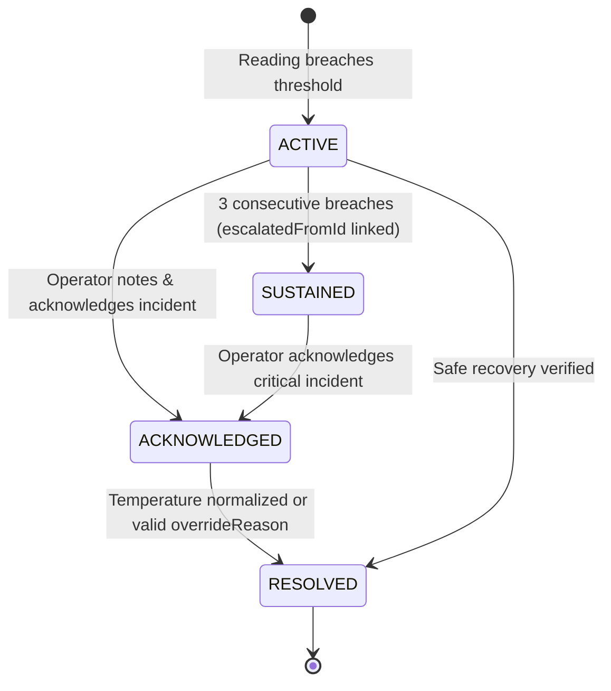
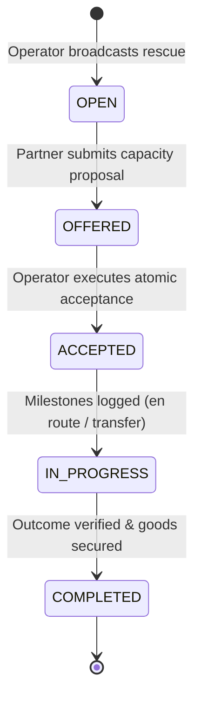

# Annapurna Rebuilt — Architecture & Technical Specifications

## Architectural Overview
Annapurna Rebuilt is designed as a **modular monolith** optimized for deployment on Vercel and managed PostgreSQL (e.g. Neon, Supabase, AWS RDS). PostgreSQL serves as the single authoritative system of record, guaranteeing ACID compliance, strict concurrency controls, and tamper-evident audit trails.


---

## Core Domain Modules

### 1. Identity & Access (`src/lib/auth`)
- Implements HMAC-SHA256 cryptographically signed session tokens with strict runtime type, payload, and finite numeric expiration validation.
- Secured via HTTP-only, SameSite=Lax cookies with timing-safe signature comparison (`crypto.timingSafeEqual`) to prevent timing attacks.
- Enforces role-based access control (`ADMIN`, `OPERATOR`, `DRIVER`, `PARTNER`).
- Production runtime strictly requires a configured `SESSION_SECRET` of 32+ characters or fails closed on boot.

### 2. Multi-Tenant Organization Boundary & Unified Authorization (`src/lib/auth/policy.ts`, `src/lib/org`)
- **Unified Policy Engine:** A single shared authorization policy (`src/lib/auth/policy.ts`) governs both API endpoints and server-rendered Next.js pages.
- **Tenant Scoping:** Operators receive access strictly through verified organization membership.
- **Driver Scoping:** Drivers are restricted to assigned shipments; unassigned shipments in the same organization are inaccessible.
- **Partner Bidding & Rescue Privacy:** Rescue partners have access only to open opportunities or accepted assignments; competitor bids, pricing quotes, fleet budgets, and internal operational notes are strictly redacted.
- **Administrative Separation:** Platform administrators (`ADMIN`) can audit fleet telemetry under `READ_AUDIT` mode, but are blocked from executing operational mutations (creating shipments, modifying device assignments, running simulations) without active tenant membership.
- **Fail-Closed Queries:** Null organization membership lookups fail closed (`FAIL_CLOSED_NO_ACCESS`) and never generate unrestricted queries.
- **Zero Credential Exposure:** Server queries use explicit Prisma `select` projections that strictly omit sensitive credential hashes (`passwordHash`, `apiKeyHash`). No password or device key hashes are ever serialized or passed to client components.

### 3. Fleet & Edge Hardware Provisioning (`src/lib/fleet`)
- Edge devices are provisioned through a secure operator workflow.
- Generates a high-entropy secret (`dev_key_apn_...`), hashes it using SHA-256 before database storage, and displays the plaintext key to the operator only once.
- Hardware specifications and temperature capability envelopes are validated prior to cargo assignment.
- Edge devices are flagged with `isSimulated: false` by default, isolating operational physical hardware from lab simulations.

### 4. Telemetry Ingestion Contract & Hardware Isolation (`src/lib/telemetry`)
Documented payload contract:
```json
{
  "deviceId": "DEVICE-APN-001",
  "sequence": 105,
  "recordedAt": "2026-10-28T10:00:00.000Z",
  "temperature": 3.8,
  "humidity": 65.0,
  "latitude": 19.076,
  "longitude": 72.877,
  "batteryPct": 94.0,
  "isSimulated": false
}
```
- **Validation:** Bounded temperatures (-60°C to +80°C), bounds on humidity (0-100%), bounds on coordinates.
- **Clock Drift:** Forward timestamps > 10 minutes are rejected (`FUTURE_TIMESTAMP_REJECTED`).
- **Deduplication & Concurrency:** Composite unique constraint `@@unique([deviceId, sequence])`. Concurrently arriving duplicate transmissions are handled idempotently via Prisma `P2002` exception handling and return `{ status: "duplicate_ignored", deduplicated: true }`.
- **Operational Hardware Isolation:** Operational devices (`isSimulated: false`) strictly reject simulated packets (`SIMULATION_NOT_PERMITTED`).
- **Out-of-Order Safety:** Out-of-order/stale readings timestamped prior to the shipment's current `latestRecordedAt` are preserved in the telemetry time series audit log without rolling back live shipment temperature, coordinates, or forward lifecycle statuses.
- **Ambiguity Prevention:** If a device is concurrently assigned to multiple active shipments, ingestion fails closed immediately (`AMBIGUOUS_DEVICE_ASSIGNMENT`).
- **Atomic Execution:** Telemetry recording, device heartbeat update, and alert evaluation execute inside a single PostgreSQL transaction.

### 5. Deterministic Alert Rules & Escalation Lifecycle (`src/lib/alerts`)
Alert evaluation is transparent, deterministic, and hysteresis-backed:
- `TEMP_HIGH_BREACH`: Temperature exceeds shipment's configured `tempMax`.
- `SUSTAINED_BREACH`: Temperature exceeds `tempMax` for 3 consecutive readings (elevates to `CRITICAL` severity). Links to initial breach alert via `escalatedFromId`.
- `TEMP_LOW_BREACH`: Temperature drops below `tempMin` (sub-cooling / crystallization risk).
- `HUMIDITY_BREACH`: Humidity exceeds `humidityMax`.
- **Deduplication:** Prevents duplicate active alerts for the same condition on the same shipment.
- **Safe Alert Resolution:** Resolving an alert requires cargo temperature to have returned to the safe operating envelope or requires an explicit operator `overrideReason` (>= 5 chars).
- **Missing Telemetry Detection:** Background detection service (`detectMissingTelemetry`) identifies active shipments exceeding expected heartbeat reporting windows.



### 6. Transaction-Safe Cargo Rescue Marketplace (`src/lib/rescue`)
When a reefer encounters mechanical failure, operators create a `RescueOpportunity`:
1. Certified rescue partners view eligible incident requests.
2. Partners submit capacity offers with price quotes (₹), available weight capacity (kg), storage type, and ETA.
3. Fleet operator selects the winning offer.
4. **Row-Level Concurrency Locking:** Acceptance acquires an exclusive PostgreSQL row lock (`SELECT ... FOR UPDATE`) on the `RescueOpportunity` to eliminate race conditions.
5. **Suitability Invariants:** Offer acceptance validates that partner capacity is sufficient (`capacityOfferedKg >= cargoWeightKg`) and facility temperature range covers cargo requirements.
6. **Offer Expiration Persistence:** Expired offers (`validUntil <= now`) are updated to `EXPIRED` in an autonomous query so status is preserved even during rollback.
7. **Single-Winner ACID Enactment:** An explicit PostgreSQL transaction marks the chosen offer `ACCEPTED`, marks all competing offers `REJECTED`, and sets `opportunity.acceptedOfferId` in a single atomic operation.
8. **Progress Milestones:** Exclusive row-level locking coordinates milestone logging (`OFFER_ACCEPTED`, `EN_ROUTE_TO_CARGO`, `ARRIVED_AT_SCENE`, `TRANSFER_COMPLETED`).
9. **Atomic Completion:** Final verification closes the incident (`COMPLETED`) and transitions shipment status to `RESCUED` together.



### 7. AI Assistance (Human-in-the-Loop) (`src/lib/ai`)
- AI is strictly advisory decision support, never the system of record.
- **Safe Fallback:** If `GEMINI_API_KEY` is absent or network requests time out (> 5000ms), a deterministic heuristic expert system calculates thermal gradients, warming velocity, and estimated minutes to threshold limit (operational heuristic, not a scientific spoilage determination).
- **Validation:** Model responses are validated via Zod schema (`AIAssistanceResponseSchema`).
- **Human Approval:** Draft messages to drivers are clearly labeled with an explicit disclaimer: *"Advisory only. Requires human verification before dispatch."*
