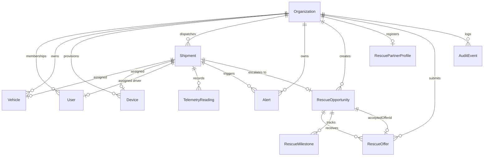

# Annapurna Rebuilt — Data Model & Lifecycle Specifications

## Relational Schema Architecture (PostgreSQL)

Annapurna Rebuilt utilizes Prisma ORM with strict relational integrity, composite unique keys, foreign keys with cascading policies, and performance indexes.

---

## Entity Definitions

### 1. `Organization`
The tenant boundary root.
- `id`: UUID (Primary Key)
- `name`: String
- `slug`: String (Unique)
- `type`: Enum (`FLEET`, `RESCUE_PARTNER`, `ADMINISTRATIVE`)

### 2. `User` & `Membership`
- `User.email`: Unique String
- `User.passwordHash`: Salted bcrypt hash
- `User.role`: Enum (`ADMIN`, `OPERATOR`, `DRIVER`, `PARTNER`)
- `Membership`: Unique composite `@@unique([userId, organizationId])` with `orgRole` (`OWNER`, `DISPATCHER`, `DRIVER`, `MEMBER`).

### 3. `Device`
Edge IoT sensing hardware.
- `deviceIdentifier`: String (Unique, e.g. `DEVICE-APN-001`)
- `apiKeyHash`: SHA-256 hash of device secret
- `hardwareModel`: String (e.g. `ANNAPURNA-EDGE-S3`)
- `status`: Enum (`ACTIVE`, `SUSPENDED`, `DECOMMISSIONED`)
- `lastSeenAt`: DateTime nullable

### 4. `Shipment`
Authoritative cargo monitoring lifecycle.
- `trackingNumber`: String (Unique, e.g. `APN-202610-01`)
- `tempMin` / `tempMax`: Float limits
- `humidityMin` / `humidityMax`: Float limits (optional)
- `status`: Enum (`DRAFT`, `DISPATCHED`, `IN_TRANSIT`, `ALERTED`, `RESCUE_PENDING`, `RESCUED`, `DELIVERED`, `CANCELLED`)
- `latestTemperature`, `latestHumidity`, `latestLat`, `latestLng`: Cached latest telemetry snapshot for zero-join dashboard queries.

### 5. `TelemetryReading`
High-volume sensor time series.
- `deviceId`: String (Foreign Key -> Device)
- `shipmentId`: String nullable (Foreign Key -> Shipment)
- `sequence`: Integer (Sequential counter from edge device)
- `recordedAt`: DateTime (Hardware timestamp)
- `receivedAt`: DateTime (Server arrival timestamp)
- `temperature`: Float
- `humidity`, `latitude`, `longitude`, `batteryPct`: Float nullable
- `isSimulated`: Boolean (Default: false)
- **Constraints & Indexes:**
  - `@@unique([deviceId, sequence])`: Strict deduplication and replay protection.
  - `@@index([shipmentId, recordedAt])`: Efficient time-series range queries.
  - `@@index([deviceId, recordedAt])`: Fleet device telemetry aggregation.

### 6. `Alert`
- `ruleCode`: String (`TEMP_HIGH_BREACH`, `SUSTAINED_BREACH`, `TEMP_LOW_BREACH`, `HUMIDITY_BREACH`)
- `severity`: Enum (`LOW`, `MEDIUM`, `HIGH`, `CRITICAL`)
- `status`: Enum (`ACTIVE`, `ACKNOWLEDGED`, `RESOLVED`, `DISMISSED`)
- `triggerReadingJson`: Serialized snapshot of reading data that triggered rule
- `acknowledgedById`, `acknowledgedAt`, `ackNotes`: Operator acknowledgment tracking
- `resolvedById`, `resolvedAt`, `resolutionNotes`: Resolution tracking

### 7. `RescueOpportunity` & `RescueOffer`
- `RescueOpportunity.status`: Enum (`OPEN`, `OFFERED`, `ACCEPTED`, `IN_PROGRESS`, `COMPLETED`, `CANCELLED`)
- `RescueOpportunity.acceptedOfferId`: UUID nullable (Unique constraint guarantees single winner)
- `RescueOffer.status`: Enum (`SUBMITTED`, `ACCEPTED`, `REJECTED`, `EXPIRED`)

### 8. `AuditEvent`
Immutable operational history.
- `action`: String (`SHIPMENT_CREATED`, `ALERT_ACKNOWLEDGED`, `RESCUE_OFFER_ACCEPTED`, etc.)
- `actorId`, `actorEmail`: Identity of mutating user
- `entityType`, `entityId`: Polymorphic target reference
- `detailsJson`: JSON serialization of mutation parameters
- `createdAt`: DateTime default now
- **Indexes:** `@@index([organizationId, createdAt])`, `@@index([entityType, entityId])`

---

## State Machine Transition Rules

| Initial State | Target State | Trigger / Guard |
| :--- | :--- | :--- |
| `DRAFT` | `DISPATCHED` | Operator assigns vehicle/device and dispatches |
| `DISPATCHED` | `IN_TRANSIT` | First telemetry reading received from device |
| `IN_TRANSIT` | `ALERTED` | Thermal breach alert triggered by alert engine |
| `ALERTED` | `IN_TRANSIT` | All active alerts resolved by operator |
| `ALERTED` | `RESCUE_PENDING` | Operator creates Rescue Opportunity |
| `RESCUE_PENDING` | `RESCUED` | Rescue Opportunity completed & cargo secured |
| `IN_TRANSIT` | `DELIVERED` | Shipment successfully arrives at destination |
| `*` (non-terminal) | `CANCELLED` | Operator cancels shipment |
