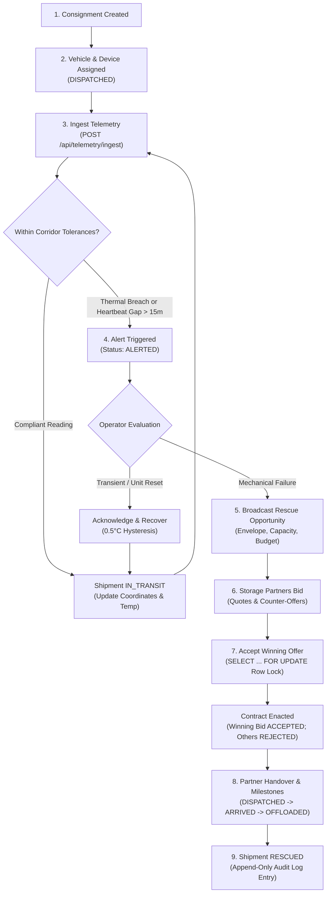

# Annapurna Rebuilt


> Cold-chain integrity monitoring and transactional cargo-rescue platform.

Annapurna Rebuilt monitors refrigerated transit consignments, evaluates IoT telemetry and heartbeat signals with deterministic rules, and coordinates emergency cargo offloading with verified cold-storage facilities before irreversible spoilage occurs.

---

## The Problem & Approach

### In-Transit Cold-Chain Vulnerabilities
Perishable cargo—such as vaccines (2°C to 6°C) and frozen food (below -18°C)—requires continuous refrigeration. Compressor trips, seal breaches, and power loss leave narrow windows before spoilage occurs. Conventional telematics rely on passive GPS trackers with delayed alerts, forcing dispatchers to coordinate emergency offloading via phone calls—risking double-booking, mismatched temperatures, and delayed arrivals.

### The Annapurna Rebuilt Approach
Annapurna Rebuilt links IoT edge monitoring directly to a transactional rescue marketplace:
- **Authenticated Ingestion:** Ingests sensor readings over HTTPS, checking bounds, sequence order, and clock drift.
- **Deterministic Escalation:** Sustained breaches and dropped heartbeats trigger `ALERTED` status with 0.5°C hysteresis.
- **Transactional Offloading:** Broadcasts rescue requests to regional cold-storage partners, executing bids atomically via PostgreSQL `SELECT ... FOR UPDATE` row locks.

---

## Core Capabilities

- **Fleet Map Console:** Leaflet maps (CartoDB tiles) tracking vehicle positions, cargo tolerances, and live shipment states ([`src/app/fleet`](./src/app/fleet), [`src/app/shipments`](./src/app/shipments)).
- **Hardened Ingestion:** Authenticated HTTPS ingestion (`/api/telemetry/ingest`) with SHA-256 keys, sequence deduplication, and drift guards ([`src/lib/telemetry`](./src/lib/telemetry)).
- **Alert Engine & Gap Scanner:** Real-time breach evaluations with 0.5°C hysteresis, plus a cursor scanner flagging silent shipments (>15 min) ([`src/lib/alerts`](./src/lib/alerts)).
- **Rescue Marketplace:** Broadcast rescue requests, negotiate counter-offers, and enact single-winner contracts via PostgreSQL `SELECT ... FOR UPDATE` locks ([`src/lib/rescue`](./src/lib/rescue)).
- **Cargo Condition Photos:** Magic-byte and dimension verification (up to 4096px, 5 MB) for uploaded evidence under RBAC ([`src/lib/images`](./src/lib/images)).
- **Multi-Tenant Access Control:** Unified policy engine ([`src/lib/auth/policy.ts`](./src/lib/auth/policy.ts)) enforcing HMAC-SHA256 sessions, driver cargo scoping, and bid redaction.

---

## Operational Workflow

The diagram below traces a consignment from dispatch through telemetry monitoring, breach escalation, and atomic rescue execution:



---

## Architecture & Technology Stack

Annapurna Rebuilt is a modular monolith backed by PostgreSQL for state and concurrency:

| Layer | Stack | Responsibility |
| :--- | :--- | :--- |
| **Framework** | [Next.js](https://nextjs.org/) `16.4.3` | App Router, Turbopack, Server Components, API routes. |
| **Runtime** | [Node.js](https://nodejs.org/) `20+` / [TypeScript](https://www.typescriptlang.org/) `5.7+` | Type-safe server execution with strict compiler checks. |
| **Persistence** | [PostgreSQL](https://www.postgresql.org/) `15+` / [Prisma](https://www.prisma.io/) `6.4.0` | Relational storage, ACID row locks (`FOR UPDATE`), migrations. |
| **Validation** | [Zod](https://zod.dev/) `3.24.2` | Runtime schema validation for API bodies and sensor payloads. |
| **Frontend** | [React](https://react.dev/) `19.0.0` / [Tailwind CSS](https://tailwindcss.com/) `4.0.0` | Server-rendered views, responsive UI, dark mode. |
| **Mapping** | [Leaflet](https://leafletjs.com/) `1.9.4` | Vehicle tracking and route corridor visualization. |
| **Security** | Node `crypto` / [bcryptjs](https://github.com/dcodeIO/bcrypt.js) `2.4.3` | HMAC session tokens and salted password hashing. |
| **Advisory AI** | Gemini API / Heuristic Fallback | Warming calculations with rule-based fallback when offline. |

---

## Quickstart & Setup Guide

### Prerequisites
- **Node.js:** `v20.x` or `v22.x` (LTS recommended)
- **PostgreSQL:** `15+` or `16+` (Local or hosted: Neon, Supabase, RDS)
- **Package Manager:** `npm v10+`

### 1. Environment Configuration
Clone the repository and prepare `.env` (`DATABASE_URL`, `SESSION_SECRET`, `NODE_ENV=development`):
```bash
git clone https://github.com/Kenkei69/Annapurna-Rebuilt.git
cd Annapurna-Rebuilt
cp .env.example .env
```

### 2. Install Dependencies & Deploy Migrations
```bash
npm install
npm run db:migrate
npm run db:generate
```

### 3. Initialize Database Records
```bash
npm run db:init-essential   # Non-destructive system roles and admin tenant
npm run db:seed             # Optional: Sample fleet data and local test personas
```

### 4. Start Development Server
```bash
npm run dev                 # Open http://localhost:3000
```

<details>
<summary><strong>Advanced Configuration & Pre-Seeded Personas</strong></summary>

#### Environment Variables Reference
| Variable | Description | Required | Default / Note |
| :--- | :--- | :--- | :--- |
| `DATABASE_URL` | PostgreSQL connection string | Yes | Requires PostgreSQL 15+ |
| `SESSION_SECRET` | HMAC cookie secret | Yes | Minimum 32 characters |
| `NODE_ENV` | Application environment | No | `development` / `production` |
| `ENABLE_SIMULATOR` | Enables lab simulator endpoint | No | Default `false` in production |
| `CRON_SECRET` | Bearer secret for heartbeat gap evaluation | Optional | Used for scheduled invocations |
| `GEMINI_API_KEY` | Gemini API key for incident advice | Optional | Falls back to rule matrix if unset |

#### Pre-Configured Development Seed Personas
When `npm run db:seed` is executed in local development, the following test accounts are provisioned:
- **Fleet Operator:** `operator@transcold.com` (`Operator123!`) — TransCold Express Logistics
- **Reefer Driver:** `driver.raj@transcold.com` (`Driver123!`) — Assigned driver for transit route
- **Rescue Partner:** `director@sahyadricold.com` (`Partner123!`) — Sahyadri Agro Cold Storage
- **Platform Admin:** `admin@annapurna.local` (`AdminPass123!`) — Governance and auditing
- **Competitor Fleet:** `operator@coastalreefer.com` (`Operator123!`) — Isolated tenant for boundary verification

#### Administrative Provisioning Command
To provision an initial production administrator with password complexity enforcement:
```bash
ADMIN_EMAIL="admin@yourdomain.com" ADMIN_PASSWORD="YourStrongPassword123!" npm run db:provision-admin
```

> **Database Safety Notice:** The destructive reset command (`npm run db:reset-demo`) is guarded by `assertSafeForDestructiveReset` in [`src/lib/db-safety.ts`](./src/lib/db-safety.ts). It strictly rejects execution against cloud hosts or databases with production identifiers. Never execute reset commands against production databases.

</details>

---

## Verification & Status

### Test Commands
Automated tests verify isolation, authentication, deduplication, state transitions, and concurrency:

```bash
npm test              # Run unit & integration test suites
npm run test:browser  # Run headless Chrome CDP browser journey test
npm run lint          # Run ESLint code quality checks
npx tsc --noEmit      # Typecheck TypeScript codebase
```

### Runtime Health Probes
- **Liveness:** `GET /api/health` returns HTTP 200 `{ status: "ok", service: "annapurna-rebuilt" }`.
- **Readiness:** `GET /api/ready` validates PostgreSQL via `SELECT 1`, returning HTTP 200 `{ status: "ready" }` or 503.

### Implementation Boundaries
- **Database:** PostgreSQL 15+; connection pooling recommended for serverless.
- **Gap Scanner:** Automated execution of `/api/telemetry/evaluate-gaps` requires an external cron trigger with `CRON_SECRET`.
- **Notifications:** In-app alerts built-in; carrier delivery requires external gateway credentials.
- **Advisory AI:** Uses deterministic heuristic fallback when `GEMINI_API_KEY` is omitted.
- **Photo Storage:** Stored in `uploads/`; serverless environments require object storage.
- **Settlement:** Manages quotes and bids; banking rails and escrow transfers are not bundled.

---

## Documentation Index

- [`ARCHITECTURE.md`](./ARCHITECTURE.md) — Service boundaries and policy evaluation.
- [`DATA_MODEL.md`](./DATA_MODEL.md) — Schema definitions, entities, and state machines.
- [`SETUP.md`](./SETUP.md) — Local development and environment setup.
- [`DEPLOYMENT.md`](./DEPLOYMENT.md) — Production deployment and rollback strategy.
- [`TESTING.md`](./TESTING.md) — Test inventory and browser verification.
- [`SECURITY.md`](./SECURITY.md) — Threat model, session crypto, and RBAC.
- [`SIMULATOR.md`](./SIMULATOR.md) — Telemetry payload contracts and scenario harness.
- [`PROVENANCE.md`](./PROVENANCE.md) — Project origin and originality declarations.
- [`THIRD_PARTY_LICENSES.md`](./THIRD_PARTY_LICENSES.md) — Dependency license disclosures.
- [`LICENSING_DECISION.md`](./LICENSING_DECISION.md) — Maintainer licensing decision guide.

---

## Authorship, Provenance & Licensing

- **Maintainer:** Kenkei69 (developed with AI pair-programming assistance).
- **Provenance:** Original implementation designed from product requirements; the prior repository (`Kenkei69/Annapurna`) remains preserved untouched (see [`PROVENANCE.md`](./PROVENANCE.md)).
- **Licensing:** License selection is reserved for the maintainer per [`LICENSING_DECISION.md`](./LICENSING_DECISION.md). Dependencies use permissive licenses (MIT, Apache-2.0, ISC).
