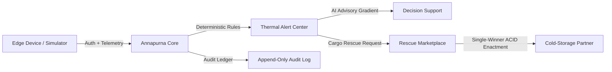

# Annapurna Rebuilt ❄️🚛

**Cold-Chain Integrity Monitoring & Autonomous Cargo-Rescue Platform**  
*Fresh, original implementation engineered from product requirements.*

Developed by **Kenkei69** with AI assistance.

---

## Executive Summary
**Annapurna Rebuilt** protects temperature-sensitive perishable goods (dairy, fresh produce, vaccines, seafood) in transit. It ingests authenticated IoT edge sensor telemetry, detects thermal anomalies via deterministic rule engines, and coordinates transaction-safe cargo rescues with verified cold-storage partner facilities before catastrophic spoilage occurs.

### Why a Rebuilt Implementation?
The maintainer previously hosted an imported snapshot of another project (`Kenkei69/Annapurna`). Due to unestablished reuse permissions in that imported repository, this project—**Annapurna Rebuilt**—was built entirely from scratch with its own modular architecture, original interface, typed database schema, deterministic state machines, and end-to-end test coverage. The original repository and its complete history have been preserved untouched. See [`PROVENANCE.md`](./PROVENANCE.md) for detailed provenance records.

---

## Core Capabilities



1. **Multi-Tenant Fleet Isolation:** Explicit organization boundaries prevent cross-tenant data leaks. Fleets cannot see competitor routes, devices, or negotiated rescue offers. Administrative roles distinguish read-only audit inspection from operational mutations.
2. **Hardened IoT Ingestion:** Devices authenticate with SHA-256 hashed API tokens. Ingestion enforces sequence deduplication, forward clock drift rejection (> 10 min), and strict boundary validation.
3. **Deterministic Alert Engine:** Transparent, hysteresis-backed detection for upper breaches, sub-cooling risks, and sustained mechanical compressor failures.
4. **Transaction-Safe Cargo Rescue:** When reefer units fail, operators broadcast rescue requests. Onboarded partner storage facilities submit capacity quotes. Operator acceptance uses PostgreSQL ACID transactions with row-level locks to enforce a strict single-winner assignment and reject competing bids simultaneously.
5. **Human-in-the-Loop AI Advisory:** Computes thermal gradients, warming velocity (+°C / 10m), and estimated time to spoilage. Drafts advisory messages to drivers with explicit human approval guardrails. Seamlessly falls back to a deterministic expert system when external AI is offline.
6. **Synthetic Telemetry Simulator:** Built-in interactive test harness (`/simulator`) emitting synthetic scenarios (Normal transit, Warming breach, Door ajar, Stale telemetry, Replay retry), clearly labeled `isSimulated: true`.
7. **Append-Only Audit History:** Every state change, acknowledgment, rescue offer, and milestone is recorded with actor email, timestamp, and metadata in an application-level append-only ledger.

---

## User Personas & Roles

| Role | Operational Scope | Pre-Seeded Demo User |
| :--- | :--- | :--- |
| **Fleet Operator** | Manages reefer vehicles, creates shipments, monitors thermal telemetry, acknowledges alerts, and accepts rescue offers. | `operator@transcold.com` / `Operator123!` |
| **Reefer Driver** | Views assigned active route, checks critical thermal instructions, and logs delivery progress. | `driver.raj@transcold.com` / `Driver123!` |
| **Rescue Partner** | Operates cold-storage warehouses or backup reefers; completes facility onboarding, bids on cargo rescue requests, and executes offloading. | `director@sahyadricold.com` / `Partner123!` |
| **Platform Admin** | Platform governance, tenant boundary auditing, and system health metrics. | `admin@annapurna.local` / `AdminPass123!` |

---

## Technical Stack
- **Framework:** [Next.js 16](https://nextjs.org/) (App Router, Turbopack, React 19)
- **Database:** [PostgreSQL 15+](https://www.postgresql.org/) with [Prisma ORM 6](https://www.prisma.io/)
- **Validation:** [Zod](https://zod.dev/) for strict API trust-boundary schemas
- **Styling:** Modern Tailwind CSS with accessible semantic color coding
- **Icons:** [Lucide React](https://lucide.dev/)
- **Testing:** Node.js native test runner (`node:test`, `tsx`)

---

## Quickstart Guide

### 1. Configure Environment
```bash
cp .env.example .env
```
Ensure `DATABASE_URL` and `SESSION_SECRET` are set in `.env`. In production, `SESSION_SECRET` must be at least 32 characters or startup will fail closed.

### 2. Install & Migrate
```bash
npm install
npm run db:migrate:deploy
npm run db:generate
npm run db:seed
```

### 3. Launch Development Server
```bash
npm run dev
```
Open [http://localhost:3000](http://localhost:3000) to access the landing page or log in with any demo persona.

### 4. Run Automated Tests
```bash
npm test
```
All 31 unit and integration tests across 6 suites will execute and verify tenant isolation, device auth, deduplication, alert generation, partner onboarding gates, and single-winner rescue transactions against PostgreSQL.

---

## Documentation Index
- [`ARCHITECTURE.md`](./ARCHITECTURE.md): System architecture, diagrams, module breakdown, and data flow.
- [`DATA_MODEL.md`](./DATA_MODEL.md): Relational schema, indexes, constraints, and state machine transition rules.
- [`SETUP.md`](./SETUP.md): Local development, database configuration, and environment setup.
- [`SIMULATOR.md`](./SIMULATOR.md): Ingestion contract and synthetic scenario harness.
- [`DEPLOYMENT.md`](./DEPLOYMENT.md): Vercel and managed PostgreSQL deployment, zero-downtime migrations, and rollbacks.
- [`TESTING.md`](./TESTING.md): Test inventory, automated test results, and browser journey reports.
- [`SECURITY.md`](./SECURITY.md): Threat model, cryptographic tokens, rate limiting, and known limitations.
- [`PROVENANCE.md`](./PROVENANCE.md): Provenance declaration, originality compliance, and licensing decision guide.
- [`THIRD_PARTY_LICENSES.md`](./THIRD_PARTY_LICENSES.md): Dependency license disclosures.

---

## Licensing Notice
An open-source license has not been attached on the maintainer's behalf without explicit selection. Kenkei69 may select an appropriate license (e.g. MIT, Apache 2.0, BSL, or Proprietary) per [`PROVENANCE.md`](./PROVENANCE.md). All underlying runtime dependencies are permissively licensed (MIT / Apache-2.0 / ISC).
